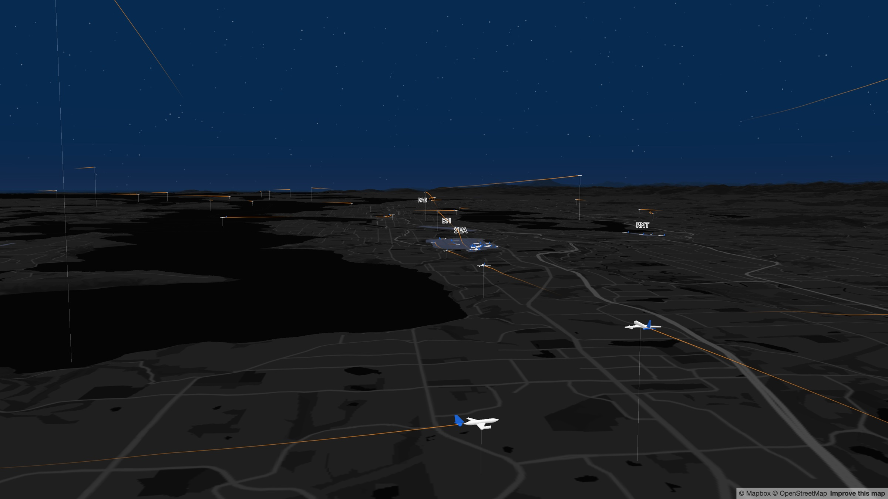
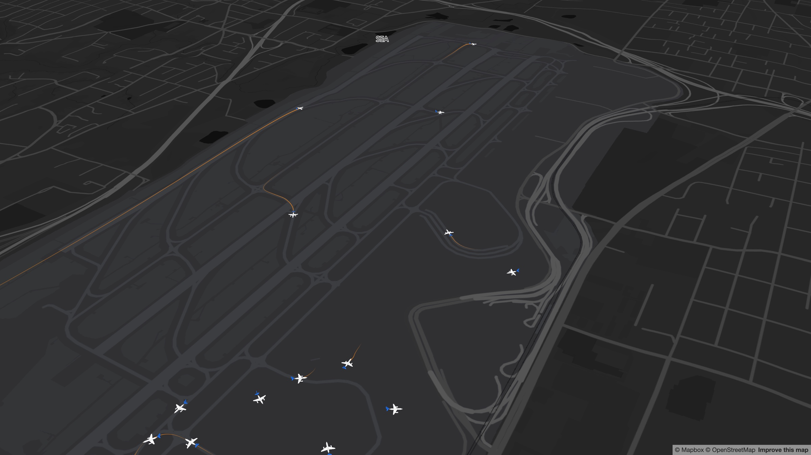
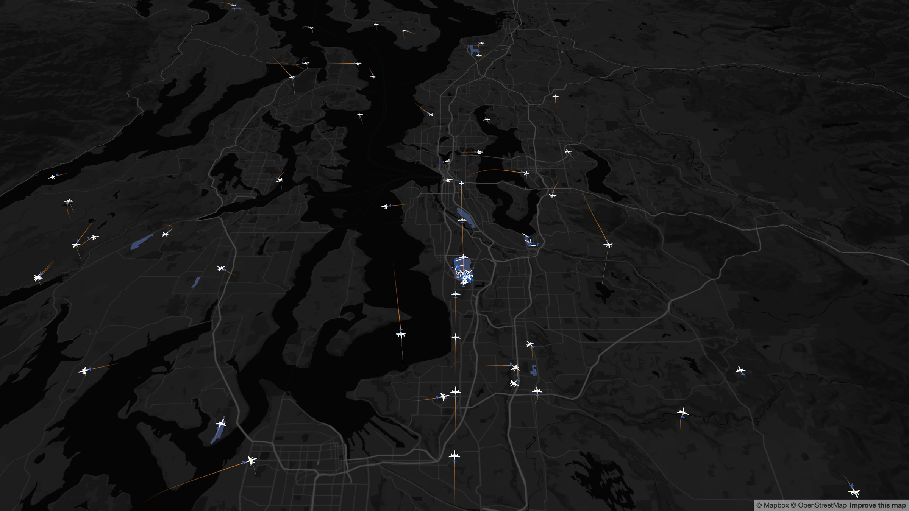

# controltower

A 3D flight tracker for the Seattle area. It records ADS-B positions from [adsb.lol](https://adsb.lol) and draws each aircraft as a true-scale model on a Mapbox map, with a fading trail of its last 60 seconds and a line down to the ground.







## How it works

- `apps/api/ingest` polls adsb.lol every 10 seconds for aircraft within 50 nm of SEA and stores their positions in PostGIS. It can also import a day of [adsb.lol globe history](https://github.com/adsblol/globe_history_2026) for replay.
- `apps/api/server` is an axum server. `GET /aircraft` returns the aircraft in a bounding box with their recent positions. API docs are served at `/docs`.
- `apps/web` is a Vite + React app. It renders aircraft with three.js in a Mapbox custom layer, interpolates between recorded positions and smooths the trails.

## Running it

You need Docker, Rust, Node and a [Mapbox access token](https://account.mapbox.com/access-tokens/).

```sh
# API
cd apps/api
cp .env.example .env
docker compose up -d             # PostGIS on port 5433
cargo run -p ingest              # start recording positions
cargo run -p controltower-server # serve on 127.0.0.1:3000

# Web
cd apps/web
cp .env.example .env        # set VITE_MAPBOX_ACCESS_TOKEN
npm install
npm run dev
```

The dev server proxies `/api` to `API_URL` (default `http://127.0.0.1:3000`).

To replay a past day instead of live traffic, import it and set `REPLAY_DATE` for the server:

```sh
cargo run --release -p ingest -- import <globe_history_dir>
REPLAY_DATE=2026-10-10 cargo run -p controltower-server
```

Don't run the poller while replaying: it deletes positions older than a day.

To run the server in Docker instead, build the image from `apps/api`. It listens on `0.0.0.0:3000`:

```sh
docker build -f server/Dockerfile -t controltower-server .
docker run -p 3000:3000 -e DATABASE_URL=<url> controltower-server
```
